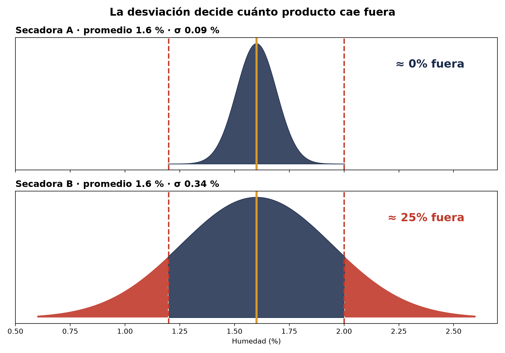
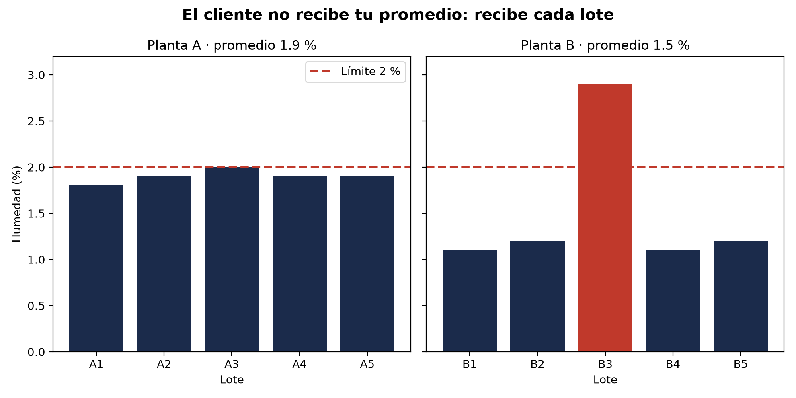
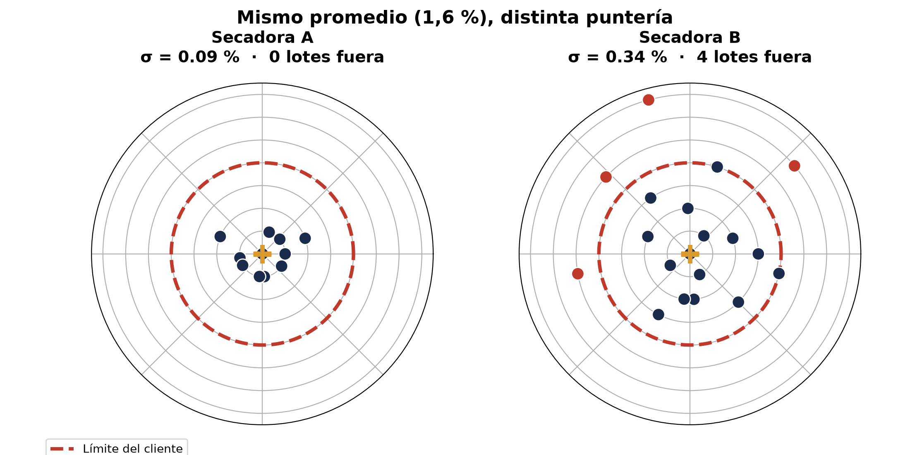

<p align="center">
  
  
  
  
</p>

Programa de formación de 52 semanas (octubre 2026 – octubre 2027) en **ciencia de datos** y **sistema integral de calidad**, aplicado a **PARAMANGLA S.A.**, una agroindustria de cacao ficticia. Cada semana publico lo que construí, lo que encontré en los datos y lo que aprendí.

> El hilo conductor: el cliente no recibe tu promedio, recibe **cada lote**. Por eso medimos la variación, no solo el centro.

---

## 🚩 Lo último

### Mismo promedio, distinta historia: la desviación estándar
PARAMANGLA tiene dos secadoras de cacao y el cliente exige humedad entre **1.2 % y 2.0 %**. Las dos promedian **1.6 %**, así que en papel son iguales. La desviación estándar dice otra cosa: la secadora A varía **0.09 %** y la B **0.34 %**. A la secadora A le caben 4.4 sigmas antes del límite; a la B, apenas 1.2. Con esa dispersión, cerca de **1 de cada 4 lotes** de la secadora B saldría fuera de especificación.

<p align="center">
  
</p>

📓 [Ver notebook](notebooks/desviacion_estandar.ipynb) · 📄 [Datos](data/raw/secadoras.csv) · 🎯 [Gráfico de diana](reports/diana_sigma.png)

---

## 📅 Bitácora

| Fecha | Entrega | Qué demuestra | Archivos |
|---|---|---|---|
| 20 oct 2026 | Desviación estándar en dos secadoras | Calcular σ a mano y con pandas; traducir variación en lotes fuera de especificación | [notebook](notebooks/desviacion_estandar.ipynb) · [diana](reports/diana_sigma.png) · [campana](reports/campana_sigma.png) |
| 19 oct 2026 | ¿El promedio dice la verdad? Dos plantas | Agrupar por planta con pandas y contar lotes fuera del límite | [notebook](notebooks/dos_plantas.ipynb) · [gráfico](reports/dos_plantas.png) |
| 17 oct 2026 | Primer notebook: humedad de 5 lotes | Promedio, máximo, mínimo y % fuera de requisito; de listas de Python a pandas | [notebook](notebooks/semana01_notebook.ipynb) |
| 17 oct 2026 | Entorno de trabajo | Entorno aislado `paramangla` y verificación de librerías | [verificar_entorno.py](src/verificar_entorno.py) · [dia1_listas.py](src/dia1_listas.py) |
| 15 oct 2026 | Línea base | Diagnóstico de entrada (ver abajo) | — |

---

## 🔎 Semana 1 · En detalle

<details>
<summary><b>¿El promedio dice la verdad? Dos plantas de cacao</b> — 19 oct</summary>

<br>

Requisito del cliente: humedad máxima de 2 %. La planta B tiene **mejor promedio (1.5 %) que la A (1.9 %)**, pero es la única con un lote fuera del límite (B3, 2.9 %). La A trabaja cerca del límite, pero estable.



**Lección:** un promedio bajo puede esconder un lote que el cliente va a rechazar.

📓 [Ver notebook](notebooks/dos_plantas.ipynb) · 📄 [Datos](data/raw/dos_plantas.csv)
</details>

<details>
<summary><b>Primer notebook: humedad de 5 lotes</b> — 17 oct</summary>

<br>

Primer análisis con listas de Python y luego con pandas sobre un CSV de lotes. En el primer grupo, 2 de 5 lotes superan el 2 % (L002 del proveedor P02 y L004 del proveedor P03). En el segundo, el promedio es 1.58 %, pero igual hay un lote fuera: la misma idea que se desarrolla después con las dos plantas.

📓 [Ver notebook](notebooks/semana01_notebook.ipynb) · 📄 [Datos](data/raw/lotes_humedad.csv)
</details>

<details>
<summary><b>Gráfico de diana: dónde apuntas y qué tan bien disparas</b> — 20 oct</summary>

<br>

Cada punto es un lote; el centro es el promedio y el círculo rojo, el límite del cliente. La secadora A agrupa todo cerca del centro; la B dispersa los lotes y 4 quedan fuera.


</details>

---

## 📊 Línea base (diagnóstico de entrada, 15 oct 2026)

| Área | Resultado |
|---|:-:|
| Python | 1/3 |
| SQL | 1/3 |
| Estadística | 1/3 |
| Calidad | 1/3 |
| **Total** | **4/12** |

Se repetirá a lo largo del programa para medir el avance con el mismo instrumento.

---

## 🗂️ Estructura

```
echb-paramangla/
├── data/raw/      # datos de entrada (CSV ficticios de PARAMANGLA)
├── notebooks/     # análisis paso a paso
├── reports/       # gráficos finales
├── src/           # scripts de Python
└── assets/        # banner
```

---

<p align="center">
  <b>Efren Cherres Bowen</b> · ECHB Consulting & Think Analytics<br>
  <i>Calidad que se mide. Datos que mejoran.</i><br><br>
  <a href="https://github.com/EfrenCherres">GitHub</a> ·
  <a href="https://www.linkedin.com/in/efren-cherres-06a60271">LinkedIn</a> ·
  <a href="https://orcid.org/0009-0006-1687-1187">ORCID</a>
</p>

<sub>PARAMANGLA S.A. es una empresa ficticia; todos los datos son simulados con fines de formación.</sub>
